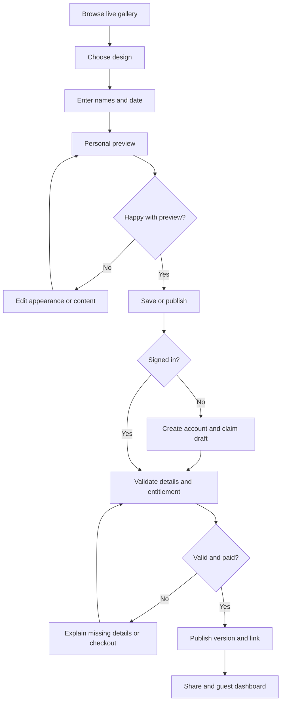
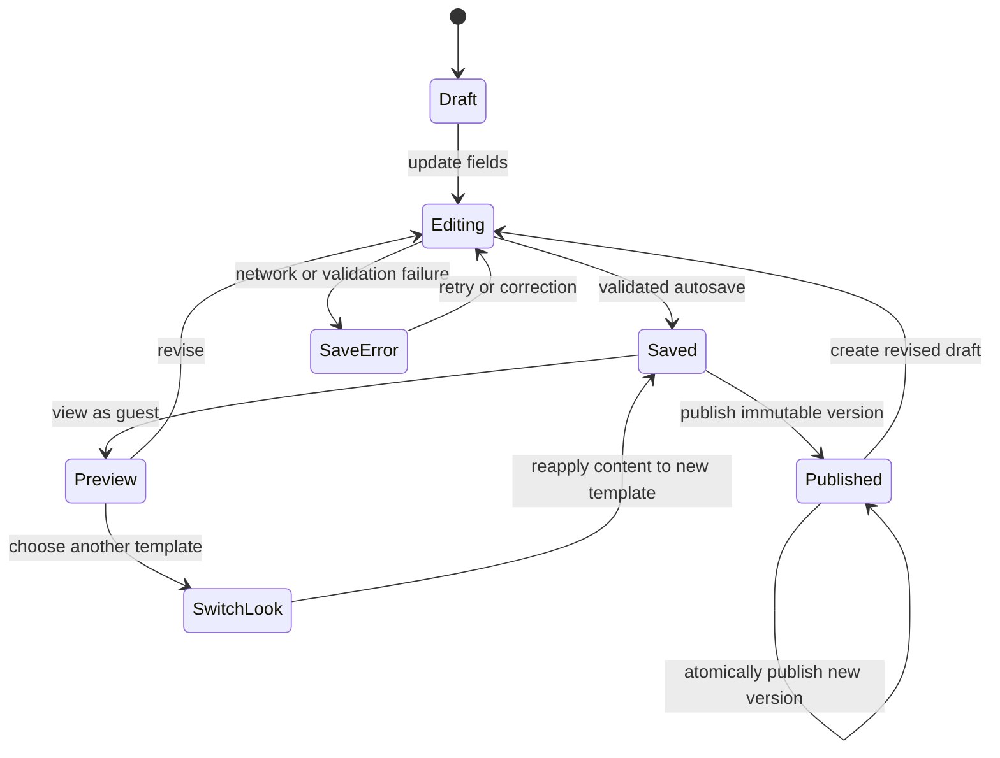
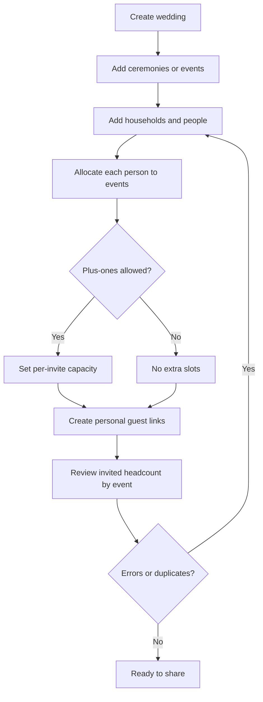
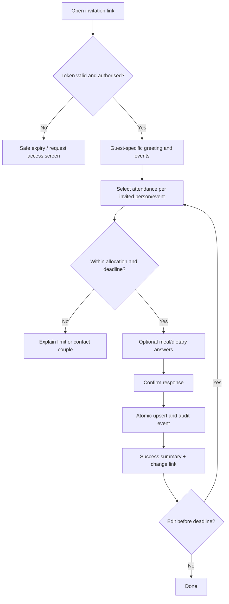
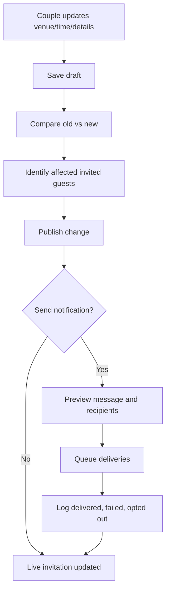
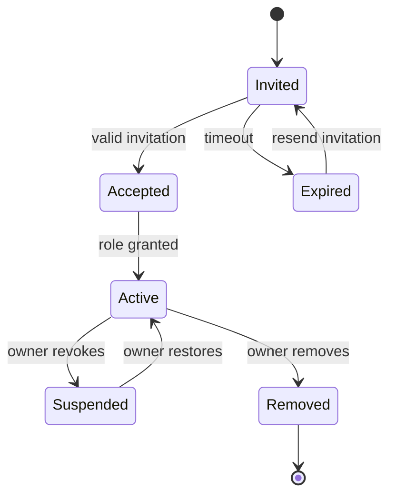
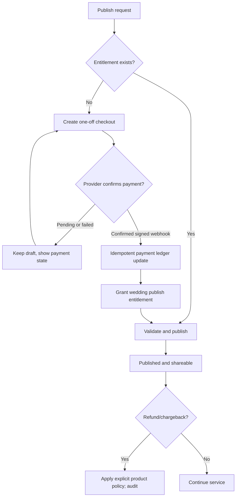
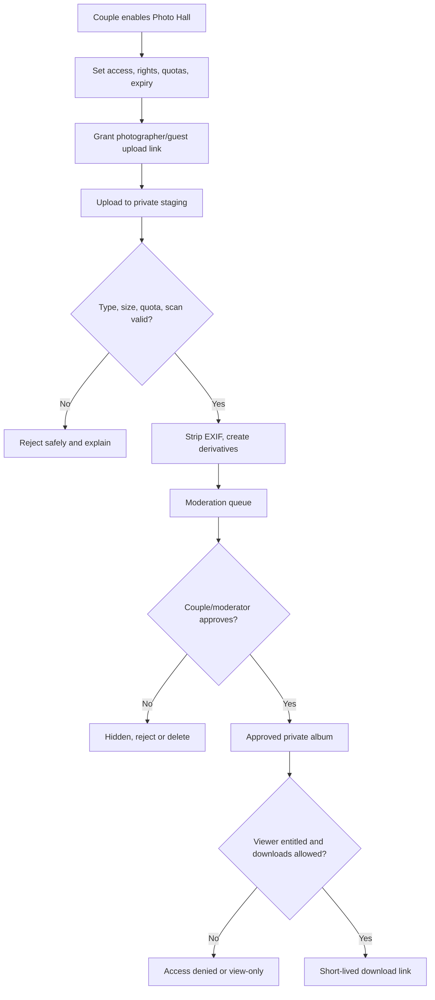
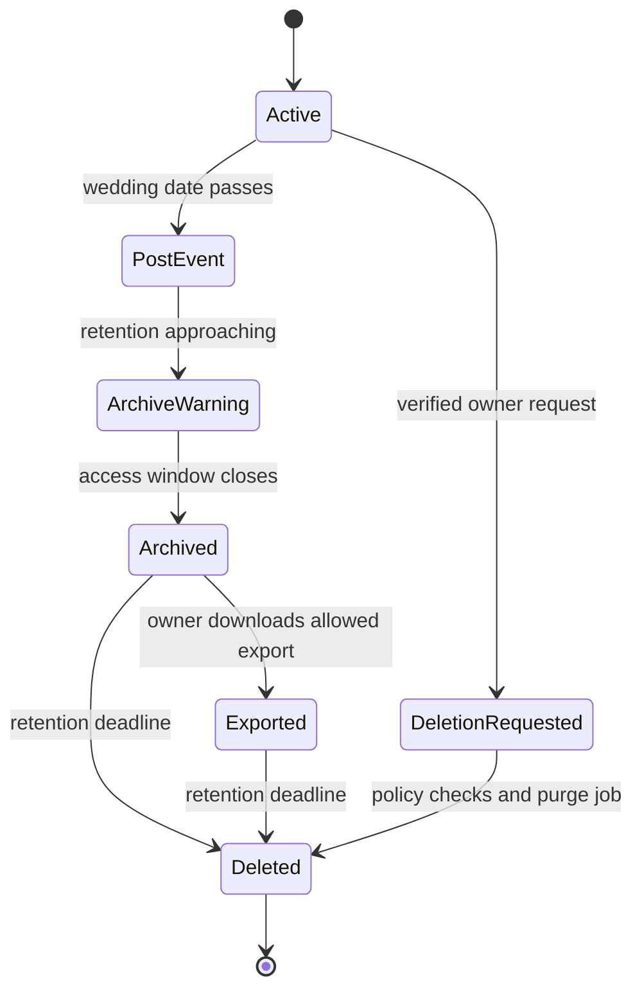
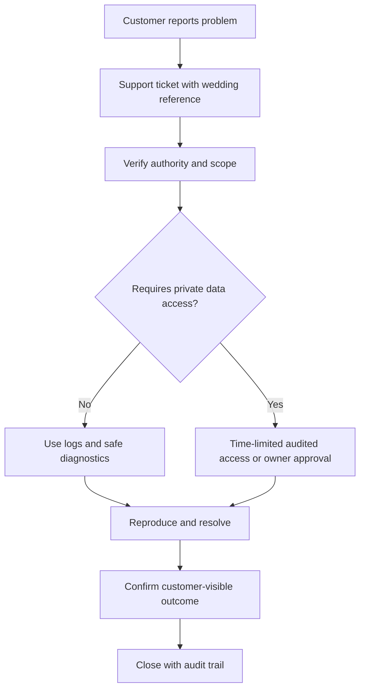

# Wedsent flow and state catalogue

**Mandatory developer contract.** Every flow below must have real UI, API, state transition, permissions, persistence and test evidence before marked done. The diagrams are planned behaviour, **not implemented functionality**.

## Flow index

| ID | Journey | Actors | Critical exceptions |
| --- | --- | --- | --- |
| F01 | Discover -> draft -> account -> pay -> publish | Couple | Abandonment, invalid data, payment failure |
| F02 | Customise -> preview -> change design -> publish version | Couple | Unsaved changes, media errors, unsupported layout |
| F03 | Add ceremonies, households, guests and permissions | Couple, collaborator | Duplicate guests, over-allocation, private events |
| F04 | Share -> token access -> RSVP -> change answer | Couple, guest | Forwarded/expired token, partial household, deadline |
| F05 | Reminder and wedding detail changes | Couple, guest | Opt-out, bounced delivery, affected subset |
| F06 | Collaborators and roles | Couple, planner | Invite expiry, revocation, privilege escalation |
| F07 | One-time payment and publishing entitlement | Couple, provider | Failure, retry, refund, duplicate webhook |
| F08 | Photo Hall ingest -> approve -> share -> delete | Photographer, guest, couple | Malicious upload, rights, takedown, quota |
| F09 | Expiry, retention and deletion | Couple, system | Export requested, pending dispute, legal retention |
| F10 | Operator support and exception recovery | Support | No access escalation without audit, privacy limits |

## F01 — discover and publish

Required cases: draft persists across sign-up and browser refresh; invalid details preserve work; checkout cancellation returns to draft; publishing idempotent; share action only offers an actual published URL.

## F02 — design customization and revision

**Latest UI contract (Atelier, 8 Nov):** Couple edits inside a single live composition workspace. Dock tools select Words, Events & places, Design & style, Photos, Soundtrack or Finishing touches. The preview has explicit Opening/Inside stages and clickable editable sections; the mobile full-screen view shows the actual guest renderer without editor chrome. The inspector maintains existing local/server draft saves and separately stored event CRUD. Changing a design preserves guest data; choosing another opening resets only the entrance override. Search (Cmd/Ctrl+K) selects tools without altering the draft. In offline/conflict/error states the header must not call a change saved. The preview/feedback link is not a published RSVP invitation.

**Studio workspace revision (8 Nov 2026):** Couple enters the Content workspace (Wording / Details / Events), changes to Design (Design / Appearance / Photos), Sound (Music), or Finishing (Extras). Workspace selections are persistent UI state only; draft editing still uses the versioned local/server model. Preview shortcuts jump to the matching inspector and select the appropriate opening/inside state. On mobile, Edit and Preview are distinct modes, and changing a workspace returns to Edit. Error paths remain the existing save conflict/offline states, media upload errors, event API errors and unplayable remote soundtrack fallback. A guest preview and feedback link must never be confused with publishing; the share route is explicitly labelled feedback only. The editor does not modify replies or guest entitlements. Sound trimming retains the recording source, start/end, trigger, and volume within the same validated invitation model.

**Studio navigation reset (8 Nov, latest):** The nested workspace selectors and redundant preview shortcut bar have been removed. The desktop has one grouped section navigator (Invitation / Creative / Finishing), the actual invitation preview, and a selected-section inspector. On mobile, the same sections form a horizontally scrollable navigation strip with a focused editing sheet and explicit Edit / Preview mode. The `Cmd/Ctrl+K` action menu searches editing tools and links to guest preview / feedback sharing. Clicking a marked region in the live invitation selects its matching inspector. Selection only changes the editing surface; existing draft/event persistence remains authoritative. Esc closes search, the action list has a no-results state, and preview links remain distinct from actual publishing. Existing documents describing the previous workspace remain historical.

Design switching must preserve ceremony/guest data. Template-specific styling may reset only with explicit notice. Published invitations never expose partial edits. Test long names, no image, RTL, mixed language, older iPhones, music muted and reduced motion. Autosave status must reflect server acknowledgement.

## F03 — ceremonies and household guest model

Data invariants: household is a delivery grouping, not one attendee. One person may attend different events with different statuses. Guest numbers must distinguish invited, accepted, declined, awaiting and extra places. Merge duplicates without losing response history. Never infer a guest's religion from ceremony name.

## F04 — private link and RSVP

**Public-link branch (build-mode implementation, 8 Nov 2026):** A published `/w/:slug` invitation links to `/w/:slug/reply`. The form asks for a name, email, attendance choice and optional note. Only events marked `everyone` may receive public replies; if no events are defined, it supports a generic wedding reply. Public submissions are stored separately in `public_rsvps`, surfaced in the owner's Replies tab as **unverified**, and are excluded from personalised guest counts, allocations and admission. Invalid/private event identifiers are rejected; write rate limiting applies. Public replies are not identity-verified or editable yet. This is not an attendance credential. `/share#...` remains a feedback-only preview with RSVP disabled because it has no persisted wedding identity.

Link forwarding: private links must not reveal the whole guest list or allow new arbitrary attendees. Shared household links require safeguards against accidental overwrite/conflict (last-change notice or per-person edit). Two concurrent responses cannot create duplicate counts. Public mode must have spam and rate controls.

## F05 — changes and reminders

Reminders should target pending people/event responses, not every household indiscriminately. WhatsApp share action is not an automated WhatsApp integration. Provider failures need visible retry paths and delivery status, not false success.

## F06 — family, partner and planner collaborators

Roles: owner, editor, guest-manager, photo-moderator, photographer-uploader, support (scoped emergency access only). Collaborators never inherit payment ownership or unbounded access by default. Revoke sessions and links when membership changes.

## F07 — payment, publish and refund

Do not grant access based on browser return URL alone. Process webhook retries exactly once. Policy for refunds, already-sent invites and service continuation needs a commercial decision before launch; never silently delete a live wedding.

## F08 — Photo Hall

Do not add facial recognition by default. Photographer rights to distribute are a separate consent/contract concern. Guest photos and children require takedown workflow, access restrictions, expiring links. Every upload and download quota must be visible before purchase, particularly if a single one-off price is promised.

## F09 — retention, archive and deletion

Record deletion jobs, irreversible data removal, storage lifecycle and backups policy. Legal invoice retention may differ from guest/photo retention. Explicit export window; never promise indefinite hosting.

## F10 — operator support

Support should be able to inspect job status, delivery failures and anonymised errors without freely reading guest lists or private photographs.

## End-to-end test matrix

| Test | Expected |
| --- | --- |
| Guest opens shared link on slow mobile | Fast readable core details, optional scene loads gracefully |
| Guest has reduced motion / sound muted | No forced animation or audio |
| Wedding uses Arabic + English | Correct RTL/LTR, layout and accessible text |
| Guest belongs to household of six | Individual event counts correct |
| Guests invited to Nikah vs Walima | Only authorised event details visible |
| Private link forwarded | No added places; scoped data only |
| Guest changes RSVP simultaneously on two devices | Last accepted event response is consistent, audit retained |
| Couple updates venue after sharing | Same link shows new version; relevant notifications logged |
| Email provider rejects recipient | Accurate failure and retry information |
| Payment times out / webhook repeats | No entitlement until verified, no duplicate charge record |
| Photographer uploads huge HEIC batch | Limits, queue, derivatives, retries and storage cost controls |
| Guest uploads an inappropriate photo | Cannot become public before moderation |
| Couple declines gallery publication | Private media remains private |
| Photographer revokes photo licence | Distribution/takedown workflow available |
| Membership revoked | Existing sessions/tokens lose access |
| Retention expires | Export and deletion policies enforced with evidence |

## Traceability template

Each packet should include:
- Flow IDs and diagram nodes implemented
- Routes/components/DB tables changed
- Error branches and permissions tested
- Screenshots at named viewport widths
- API and database proof for state mutations
- Accessibility and performance findings
- Source licence entries and new dependencies
- Remaining blocked flows

Update this file when a workflow changes **before** implementation. No agent may mark a feature complete while its mandatory flow branches are undocumented or unverified.
